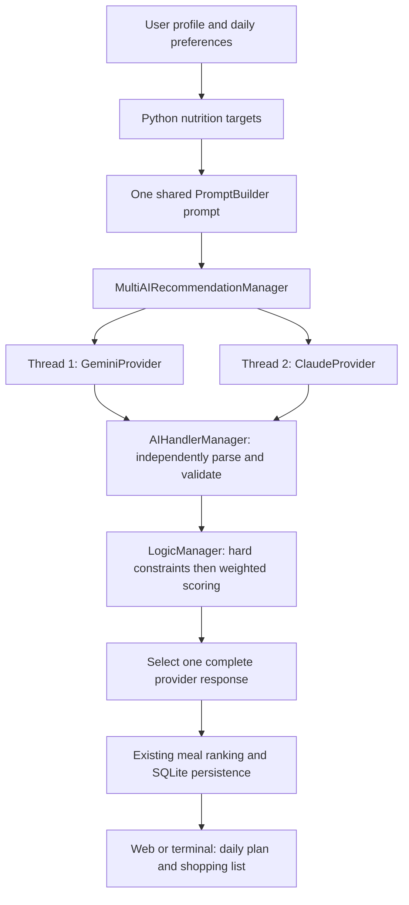

# Calora: personalised meal planning

Calora is a Python OOP application for Singapore meal planning. It uses a user's
profile, nutrition targets, allergies/restrictions, food preferences, pantry,
meal source and SGD budget to build breakfast, lunch and dinner plans.
Profiles and previous plans are stored in SQLite. Web and terminal interfaces
share the same controller and managers.

Repository: https://github.com/NatelieNeo/LAB-P12-Team2-OOP.git

## Gemini + Claude concurrent recommendations

`AI_MODE=multi` submits **two requests to real Python threads**: Google Gemini
and Anthropic Claude receive the exact same business prompt. Both results are
collected and independently parsed by the existing handler. The Logic Manager
compares the complete response sets and chooses by suitability, never by speed.
It builds the displayed three-meal plan entirely from the winning provider's
ten recommendations. Recommendations from different providers are never mixed.



### Architecture and reuse

The original project already had `AIProvider`, `GeminiProvider`, `PromptBuilder`,
`AIHandlerManager`, domain models, a controller, input validation, meal rules,
ranking strategies and normalized SQLite storage. Its entry points still called
older function-based interfaces, and missing job imports prevented startup.
Those integration gaps are repaired so the new feature runs through Calora.

| Component | Responsibility |
|---|---|
| `manager/ai_manager.py` | Existing provider abstraction, Gemini adapter, new Claude adapter, shared prompt, bounded retries, concurrent collection and worker timings |
| `manager/ai_handler_manager.py` | Exact JSON schema/count checks and conversion to `MealCandidate` objects |
| `manager/logic_manager.py` | Existing nutrition calculations, dietary/source filters, per-meal ranking, shopping list; new complete-set comparison and strict-budget combinations |
| `manager/models.py` | Existing profiles/requests/plans; typed `AIResponseSet` and `ResponseSelection` objects |
| `manager/controller.py` | Configuration-based construction, orchestration, selection and saving exactly one plan |
| `manager/io_manager.py` | Shared CLI/web input validation and terminal output |
| `manager/data_manager.py` | Unchanged SQLite profile/plan persistence; no schema migration |
| `app.py`, `main.py` | Existing Flask routes/templates and terminal menu connected to the controller |

The existing response schema is retained: `estimated_nutrition_targets` and
exactly ten `recommendations`, with meal type/name/source, numeric calories,
protein/carbs/fat/cost, portion size, pantry ingredients, ingredients and recipe
steps. Extra/missing fields are rejected. Numbers must also be finite,
non-negative, and not booleans; calories must be positive. Ingredient entries
remain strings or objects with item/quantity/unit. Existing nutrition targets
are calculated in Python, rather than trusting the AI's returned target values.

### Why this is multithreading

`MultiAIRecommendationManager.get_response_sets()` creates a
`ThreadPoolExecutor(max_workers=2)`, calls `executor.submit()` for each provider
**before waiting**, then collects Futures with `wait(..., FIRST_COMPLETED)`. Each worker
uses the existing `AIManager` retry/parser path. Each real SDK request creates
and closes its own client; per-request collections and failures are local.

API waiting is I/O-bound, so waiting for Gemini and Claude overlaps. Sequential
execution waits for Gemini and then starts Claude; concurrent execution starts
both and waits approximately for the slower successful request, plus overhead.
Validation and Python scoring are separate from this network concurrency.
Calora deliberately waits for both responses, or the collection deadline,
because the slower response might be more suitable.

The HTTP Flask route remains synchronous while its two AI worker threads run.
The existing background-job classes and polling assets remain available; this
feature does not depend on process-local polling across Gunicorn workers.

### Deterministic selection

First, a response is ineligible if it has the wrong count, unknown ingredients,
any candidate rejected by the existing dietary rule, a meal-source violation,
or cannot produce a complete breakfast/lunch/dinner plan. One unsafe candidate
disqualifies that provider's entire set. Known vegetarian/vegan ingredient terms
and phrases such as `no peanuts` are normalized and checked in Python.

The existing `LogicManager.rank_slot()` priority remains calorie fit, macro fit,
food preference, then cost. Targets use Mifflin–St Jeor BMR, activity multipliers,
and the existing goal adjustments/macro ratios. Each candidate is compared with
the **per-meal** target, not the full-day target.

Eligible complete sets receive a score out of 100. Weights are editable in
`config.RESPONSE_SCORE_WEIGHTS`:

| Component | Weight | Calculation, before weighting |
|---|---:|---|
| Calories | 30 | Mean `max(0, 1 - abs(actual-target)/max(abs(target),1))` across all ten candidates |
| Macros | 25 | Mean of that relative-fit formula for protein, carbs and fat, across all candidates |
| Budget | 15 | `min(1, daily_budget / chosen_plan_cost)`; 1 without a budget, 0 for unknown costs |
| Food preference | 10 | Fraction matching the existing cuisine/craving matcher |
| Meal source | 5 | Fraction matching the requested source (all pass the hard source gate) |
| Pantry | 5 | Mean fraction of home-cooked ingredient names covered by pantry substring matches; 1 if inapplicable |
| Variety | 5 | Unique normalized dish-name token sets divided by recommendation count |
| Practicality | 5 | Fraction of eat-out options or home-cooked options with recipe steps |

Final score is `100 * sum(weight * component) / sum(weights)`. Higher wins.
Exact ties use lower chosen daily cost, then lexicographically sorted normalized
recommendation content, then provider label only if those are also equal.
Response arrival order and latency do not affect the score or tie-breaker.

Daily budgets stay **advisory by default**, preserving the existing behaviour.
Choose **Strict budget** in the web form or answer `yes` at the CLI prompt to
make it a hard limit. The existing model-building code then checks combinations
from the provider's three meal slots and selects the best feasible combination
using its existing ranking criteria. No feasible day means rejection, even if
the provider has a high nutrition score. Blank/0 budget means no limit. A strict
flag is request-only; the saved numeric budget remains available next time.
Daily cost totals are rounded to two decimal places for SGD budget comparisons.

### Configuration and installation (Windows PowerShell)

The code targets Python 3.11+. The Docker Gunicorn timeout is 240 seconds so its default
30-second limit does not interrupt multi collection or the retained legacy retries.
Dependencies include the official
`google-genai>=3.0.0,<4` and `anthropic>=1.17.0,<2` SDKs. Existing Flask,
python-dotenv and pytest dependencies are retained. These SDK versions use
their `httpx2` transport dependency; Calora does not add a second HTTP client.

```powershell
python -m venv .venv
.\.venv\Scripts\python.exe -m pip install -r requirements.txt
Copy-Item .env.example .env
# Edit .env locally; do not commit it.
.\.venv\Scripts\python.exe app.py
# Open http://127.0.0.1:8080
# Or use the terminal menu:
.\.venv\Scripts\python.exe main.py
```

Get a Gemini key from [Google AI Studio](https://aistudio.google.com/api-keys).
For Claude, sign in to the [Claude Console](https://platform.claude.com/), select
your organization/workspace, configure API billing/credits if required, and
create an API key in its API Keys settings. Set `ANTHROPIC_API_KEY` in your local
`.env`. A consumer chat subscription does not configure Calora's API access.
Choose model IDs available to your account; no keys are embedded in source.

| Environment variable | Default / meaning |
|---|---|
| `GEMINI_API_KEY` | Required for Gemini requests |
| `ANTHROPIC_API_KEY` | Required for Claude requests |
| `GEMINI_MODEL` | `gemini-3.1-flash-lite`, preserving the previous primary |
| `CLAUDE_MODEL` | `claude-sonnet-5-5` |
| `AI_MODE` | `gemini`, `claude`, or `multi`; the example explicitly enables `multi` |
| `AI_REQUEST_TIMEOUT_SECONDS` | 45 seconds per SDK network request |
| `AI_TOTAL_TIMEOUT_SECONDS` | 60 seconds for collecting multi-AI results, including retries |
| `AI_MAX_OUTPUT_TOKENS` | 8192; increase if Claude reports truncated output |
| `FLASK_SECRET_KEY` | Configure a random secret for Flask sessions |

With `AI_MODE` unset/blank, both keys select `multi`; otherwise the historical
Gemini workflow is retained. Explicit `gemini` calls only the primary Gemini;
explicit `claude` calls only Claude. Explicit `multi` always attempts both and
logs any missing-key failure rather than silently changing modes. The resolved
mode is logged at startup/manager construction. Models are resolved lazily so
`.env` values loaded by the entry points take effect.

For backwards compatibility only, when `AI_MODE` is blank and Gemini is the
resolved mode, the old first-valid **two-Gemini race** is still controlled by
`CALORA_PARALLEL_AI` and `GEMINI_FALLBACK_MODEL`. It is separate from intelligent
Gemini/Claude comparison. Set an explicit mode for the new documented workflow.

### Failure handling and timing

One failed, malformed, unauthenticated, rate-limited or timed-out provider does
not discard the other valid response. Each provider gets at most the existing
`MAX_RETRIES=3` attempts; successful peers are never repeated. SDK retries are
disabled to avoid multiplying application retries. Authentication/client errors
are non-retryable; connection failures, 408/409/429 and server errors are
retryable within the deadline. Unexpected programming errors propagate rather
than being disguised as network outages.

Both invalid responses raise `AIResponseError`; all connection failures raise
`AllProvidersFailedError`; all unsuitable sets raise `NoSuitableMealsError`.
The web error handler returns a controlled error page (400 for invalid input,
503 for application failures); the CLI displays the application error and
returns to its menu. Failed attempts never save a meal plan.

`time.perf_counter()` records each worker's start/end and elapsed time, total
concurrent collection time and Logic Manager comparison time. Logs include
provider/model labels, component scores and the selected provider. They exclude
full prompts, profiles, keys and raw SDK error bodies. Worker time includes
validation and any application retries, not just a single HTTP round trip.

Python cannot forcibly stop a running thread. At the collection deadline,
pending Futures are cancelled and late results ignored; an already-running SDK
call ends under its network timeout. That worker may outlive the collection
deadline until its current request completes; it starts no further retry after
the deadline. SDK network timeouts are transport timeouts, not a guarantee that
arbitrary injected provider code terminates. Normal completed workers and SDK
clients are cleaned up. Actual paid multi-mode calls use both providers' quotas.

### Testing and lecturer demonstration

```powershell
.\.venv\Scripts\python.exe -B -m pytest -q -p no:cacheprovider
.\.venv\Scripts\python.exe -B benchmark_multi_ai.py --delay 2
# Focus on the concurrency proof and selection tests:
.\.venv\Scripts\python.exe -B -m pytest tests/test_multi_ai.py -v --log-cli-level=INFO
```

The benchmark uses fake providers through the real shared prompt, parser,
thread-pool and comparison code. It makes **zero paid API calls** and is never
run automatically by Calora. Two simulated two-second calls take approximately
four seconds sequentially and two concurrently; printed values are measured,
not hardcoded. Machine load can affect elapsed time.

1. Show `ThreadPoolExecutor(max_workers=2)` and both `submit()` calls in the AI Manager.
2. Run the barrier-based overlap test: neither provider can return until both
   worker threads are inside `generate()`. Sequential calls would break the barrier.
3. Run the benchmark and compare sequential/concurrent totals and overlapping intervals.
4. Show the test where the better response wins even though the first valid
   response has already started returning; show the rejection and failover tests.
5. Optionally set both real keys and `AI_MODE=multi`, generate one plan, and show
   thread names, start/end times, scores and the selected provider in logs.
   This final optional step consumes API credits; ordinary tests never do.

Tests cover SDK method/response adaptation, timeouts and retry classification,
shared prompts, real worker overlap, provider attribution, strict JSON/count
validation, nutrition scoring, restrictions, advisory/strict budgets, duplicate
penalties, deterministic ties, provider failures, legacy tests, and web/CLI
profile/plan/history flows using temporary SQLite databases.

Presentation explanation: “Calora builds one prompt and submits Gemini and
Claude to two ThreadPoolExecutor workers. Futures let their network waiting
overlap. Each answer is independently validated. The Logic Manager rejects
unsafe or incomplete sets, scores eligible sets using Python rules, and builds
the day's plan from one winning provider. Speed never determines suitability.”

### OOP concepts and practical limits

- **Abstraction/inheritance/polymorphism:** `AIProvider` is an abstract base;
  Gemini, Claude, stub and legacy parallel providers implement `generate()`.
  Tests inject fake implementations of the same contract.
- **Encapsulation:** adapters own credentials/client configuration; domain
  objects expose existing properties; typed result objects keep provider
  attribution and timings together.
- **Aggregation/dependency injection:** the controller receives AI/logic/data/job
  managers; the multi manager receives providers and a validator. API details,
  collection, parsing, scoring, storage and presentation remain separate.
- Existing `MealRule` and `RankingCriterion` subclasses continue to provide
  replaceable filtering/ranking behaviour.

Nutrition, ingredient lists and prices are **AI estimates**, not independently
verified facts. Dietary matching uses known ingredient/dish keywords and cannot
guarantee allergy safety, cross-contamination safety, religious certification or
complete understanding of arbitrary free-text restrictions. Variety detection
normalizes names; it does not understand semantic recipe similarity.

The existing single-provider paths retain partial-plan/source-fallback behaviour;
multi comparison requires complete, source-compatible sets. Selected-provider
scores and component metadata are shown for the newly generated plan and logs,
but are not persisted in the existing database schema. Ingredient quantities and
recipe steps have the original persistence/display limitations: recipe steps
are not retained in `PlannedMeal`, and stored ingredient names lose quantities.
Username sign-in remains the original password-free profile selector.

Official references: [Google Python SDK](https://googleapis.github.io/python-genai/),
[Google model IDs](https://ai.google.dev/gemini-api/docs/models),
[Anthropic Python SDK](https://platform.claude.com/docs/en/cli-sdks-libraries/sdks/python),
[Claude model IDs](https://platform.claude.com/docs/en/models/overview).

## Implementation inventory and verification

Modified files:

- `.gitignore`, `Dockerfile`, `README.md`, `requirements.txt`, `config.py`
- `app.py`, `main.py`
- `manager/ai_manager.py`, `manager/ai_handler_manager.py`, `manager/controller.py`
- `manager/logic_manager.py`, `manager/models.py`, `manager/io_manager.py`, `manager/job_manager.py`
- `templates/form.html`, `templates/_plan_content.html`
- `docs/README_parallel_ai_section.md`, `docs/exception_matrix_parallel_ai.md`

New files:

- `.env.example`
- `benchmark_multi_ai.py`
- `tests/test_multi_ai.py`
- `tests/test_app_workflow.py`

Verification performed during implementation:

- 105 tests passed, including all 35 existing tests, using Python 3.15.2.
- Installed Google Gen AI 3.0.0 and Anthropic 1.17.0 SDKs were exercised with
  in-memory HTTP transports, without contacting provider servers.
- The two-second fake-provider benchmark measured 4.003 seconds sequentially
  and 2.028 seconds concurrently (1.97x); worker intervals overlapped.
- Python syntax/import checks, Python 3.11 grammar parsing, `git diff --check`
  and `pip check` passed. Python 3.11 runtime and a Docker image build were not tested.
- Neither API key was configured in this environment, so no live-provider calls
  were made. All API behaviour was verified using injected providers/transports.

If pytest's default temporary directory is inaccessible in your local sandbox,
use a fresh workspace directory, for example
`python -B -m pytest -q -p no:cacheprovider --basetemp=.test-tmp-local-1`.
Pytest owns/clears its `--basetemp` directory: always use a dedicated test folder.
